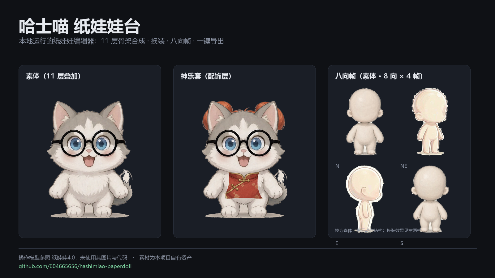

# 哈士喵 纸娃娃台


本地运行的纸娃娃编辑器。11 层骨架实时合成、换装、八向帧播放、一键导出，
外加一套配套工具：截图批量入库、素材体检、结构参考卡生成。



在线试用：**https://604665656.github.io/hashimiao-paperdoll/**
　｜　路线图看板：[Projects · 哈士喵纸娃娃台](https://github.com/users/604665656/projects/2)

> 操作模型参照 [纸娃娃4.0](https://mxd.dvg.cn/zhiwawa_v4/)，只复刻交互方式，
> 未使用其任何图片、代码或数据。素材全部为本项目自有资产。

---

## 能做什么

| 能力 | 说明 |
|---|---|
| 图层合成 | 11 个骨架槽位（尾巴/身体/头/嘴/左右眼/眼镜/发型位/左右手/腰挂位），逐层显隐、透明度、上下移动 |
| 换装 | 配饰层整图（假发 + 衣身），插入位置可选，两套现成（神乐 / 土方） |
| 微动 | 呼吸起伏、自动眨眼、说话口型、尾巴摆动、歪头角度 —— 因为素材是单源分层，可以做局部变换 |
| 八向帧 | 8 方向 × 4 帧播放，FPS 2–24、循环、单帧步进、洋葱皮对位 |
| 画布 | 滚轮缩放、拖拽平移、棋盘/深色/白底/透明背景、网格、边框、像素放大 |
| 导出 | 当前视图 PNG、×2 高清、8×4 雪碧图、单方向帧条、11 层逐张 |
| 存档 | localStorage 方案列表、自动恢复上次状态、搭配码（base64）、方案 .json 导入导出 |

渲染是单 canvas 手写合成，没有框架、没有构建步骤、没有 npm。

---

## 快速开始

```bash
git clone https://github.com/604665656/hashimiao-paperdoll.git
cd hashimiao-paperdoll
```

双击 `启动.bat`，或手动：

```bash
python -m http.server 8777
# 打开 http://127.0.0.1:8777/index.html
```

`index.html` **不能**用 `file://` 直接打开，中文路径下的图片会加载失败。

## 快捷键

`空格` 播放/暂停 · `F` 适配 · `1-4` 切标签 · `←/→` 逐帧 · `M` 镜像 · `R` 随机
滚轮缩放 · 拖拽平移

---

## 目录

```
index.html              主界面
css/ js/                样式与逻辑（app.js 渲染、parts.js 槽位表）
assets/单源版/           11 层骨架 1328×1776 同画布 + 配饰层
assets/八向资产/         8 向 × 4 帧 160×190 + 候选帧 + 校验图
assets/参考图_素体网格/   另一套素体姿态网格实验（工具不依赖）
参考卡/                  结构参考卡（原创绘制 + 自有剪影）
素材交付/                待交素材的目录骨架与规格清单
素材入库/                截图批处理流水线（inbox → out）
开发日记/                按天记录改动、决策与坑
tools/                   Python 脚本与双击入口
docs/                    README 用图
```

## 三套配套工具

| 工具 | 干什么 | 入口 |
|---|---|---|
| 素材体检 | 查缺件 / 尺寸 / 透明通道 / 命名，出报告，可一键装进 assets | `tools/体检.bat` |
| 截图批量入库 | 截图 → 去背 / 切图 / 归一化 / 命名 / index.json / 总览图 | `tools/入库.bat` |
| 结构参考卡 | 头身比、衣褶四型、重心动态线；八向剪影 + 中轴 + 刻度 | `tools/生成参考卡.bat` |

工具链依赖 Python 3.10+ 与 Pillow / numpy / scipy；只跑网页不需要任何依赖。

规格与用法：[`素材交付/素材清单.md`](素材交付/素材清单.md) ·
[`素材入库/README_入库说明.md`](素材入库/README_入库说明.md) ·
[`参考卡/README_参考卡说明.md`](参考卡/README_参考卡说明.md)

## 改完怎么同步

1. 在 `开发日记/YYYY-MM-DD.md` 追加一条（格式见 `开发日记/README.md`）
2. 双击 `推送.bat "改了什么"` —— 自动 add / commit / push，带重试与 sha 校验

## 常见问题

<details>
<summary>为什么推送总报 CONNECT tunnel failed / SSL eof</summary>

本地走 HTTP 代理时，对 GitHub 的长连接容易断。脚本已用 `http.version=HTTP/1.1`
与 `pack.threads=1` 降低单连接压力，并在每次推送后比对 `rev-parse HEAD` 与 `ls-remote` 的 sha。
资产体积大时，建议拆小批次提交再推送。
</details>

<details>
<summary>为什么八向帧是素体，没有五官和衣服</summary>

八向帧用于动作结构对位，与分层立绘是两条链路：分层走合成，八向走预生成帧。
换装效果看分层模式，动作连贯性看八向模式。
</details>

<details>
<summary>能直接换成别的角色吗</summary>

可以。保持 1328×1776 同画布、PNG 带 alpha、不裁切，按 `L00~L10` 命名替换
`assets/单源版/01_骨架层/`，再改 `js/parts.js` 里的槽位表即可。
</details>

---

## 许可

- 代码（`index.html`、`css/`、`js/`、`tools/`）：MIT，见 [LICENSE](LICENSE)
- 美术资产（`assets/`、`参考卡/`、`docs/`）：保留版权，未经许可不得单独取用或再分发

## 开发日记

决策过程、踩过的坑、验证数据，都在 [`开发日记/`](开发日记/)。

同作者的其他项目与看板：[github.com/604665656](https://github.com/604665656)
